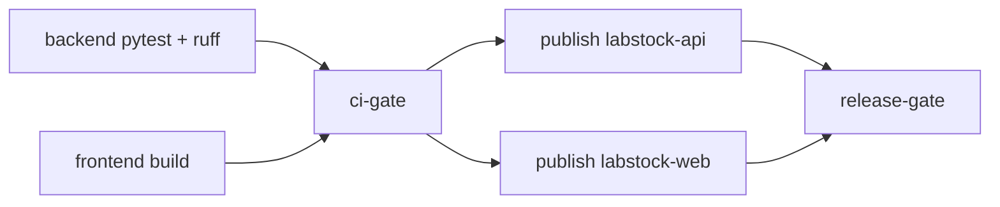

# 班级实训耗材智能管理系统

面向班级实训场景的耗材管理系统，覆盖耗材建档、批量领用、红冲撤销、库存预警、智能补货建议、处置入库与全链路操作日志。前后端分离，可通过 Docker Compose 在单台云服务器上一键部署为生产可用系统。

## 功能

- **三角色权限**：学生自助领用与查询，教师/班委代登记与撤销，班委维护耗材档案与用户
- **耗材档案**：新增、修改、停用/启用，同班重名校验，安全库存阈值配置
- **批量领用**：单次最多 5 行，整单原子扣减，任一行库存不足则整单回滚
- **红冲撤销**：不删除、不修改原流水，回退库存并生成红冲流水，支持双向追溯
- **库存总览**：低库存与缺货自动置顶，汇总总类数、预警数、今日领用量
- **智能补货**：规则引擎判定紧急/一般/观察三级并给出判断依据；配置大模型后仅用于措辞润色，超时自动降级为规则模板
- **处置入库**：补货建议页直接登记到货数量，原子增加库存并留痕，形成补货闭环
- **统计与审计**：7/30 天净消耗（领用 − 红冲）、库存反推审计、操作日志全链路留痕、记录筛选与 CSV 导出

## 技术栈

| 层 | 选型 |
| --- | --- |
| 后端 | Python 3.12、FastAPI 0.115、SQLAlchemy 2.0、Alembic、PyJWT、bcrypt |
| 前端 | Vue 3.5、Vite 5、Element Plus、Pinia、Axios、vue-router 4、ECharts 5 |
| 数据库 | MySQL 8.0（由 Compose 内置；本地开发可用 SQLite 兜底） |
| 部署 | Docker Compose（nginx + uvicorn + MySQL），GHCR 镜像 + GitHub Actions CI/CD |

## 环境要求

- 生产部署：Linux 服务器（Ubuntu 22.04/24.04 推荐），Docker Engine + Compose 插件，2 核 4G / 磁盘 ≥ 20G
- 本地开发：Python 3.12+、Node.js 18+（推荐 20+）；可选本机 MySQL 8.0

## 快速开始（服务器部署）

服务器部署**只拉取镜像，不本地构建**。构建由 GitHub Actions 在仓库端完成并推送 GHCR，服务器只做 `pull` 与 `up`。

```bash
# 1. 安装 Docker（Ubuntu，已安装可跳过）
curl -fsSL https://get.docker.com | sh -s -- --mirror Aliyun
systemctl enable --now docker

# 2. 获取代码
git clone https://github.com/IceFireIcer/manage_system.git
cd manage_system

# 3. 配置生产密钥（生产环境必做，见「配置」一节）
cp .env.example .env
chmod 600 .env
# 编辑 .env：MYSQL_ROOT_PASSWORD、MYSQL_APP_PASSWORD、MYSQL_MIGRATE_PASSWORD、MYSQL_BACKUP_PASSWORD、JWT_SECRET_KEY 必须替换为随机值

# 4. 拉取 GHCR 镜像并启动（私有包需先 docker login ghcr.io）
docker compose pull
docker compose up -d
docker compose ps

# 5. 获取管理员初始密码
docker compose logs backend | grep bootstrap
```

浏览器访问 `http://<服务器IP>:4900/`（或 `http://<服务器IP>:<WEB_PORT>/`），使用上一步打印的管理员账号登录。

- **本地开发调试可构建，服务器部署不要构建**：`docker-compose.build.yml` 仅用于本地开发与调试；服务器正式部署一律 `pull`
- 仓库地址必须是 `https://github.com/IceFireIcer/manage_system.git`；镜像名必须是 `ghcr.io/icefireicer/labstock-api` / `ghcr.io/icefireicer/labstock-web`。若误用 `IceFirerer` 或其他仓库名，会出现 clone 404 或镜像名不匹配、pull 失败
- GHCR 包默认私有：可在 GitHub Packages 将 `labstock-api` / `labstock-web` 设为 public；或服务器用带 `read:packages` 权限的 PAT 执行 `docker login ghcr.io -u <GitHub 用户名>` 后拉取
- 镜像版本由 `IMAGE_TAG` 指定（默认 `latest`）
- 拉取慢或 `docker: unknown command: docker compose`：见 [docs/deploy.md](docs/deploy.md) 第 3.1 节「国内网络优化」与第 12 节「常见问题排查」

- 健康检查：`curl -fsS http://127.0.0.1:4900/api/v1/health` 应返回 `{"status":"ok"}`
- 完整部署、运维、备份恢复、升级回滚与排错见 **[docs/deploy.md](docs/deploy.md)**
- 交付范围与已知限制见 **[docs/delivery.md](docs/delivery.md)**，逐项验收见 **[docs/acceptance-checklist.md](docs/acceptance-checklist.md)**

## 管理员初始化

后端容器每次启动都会执行 `alembic upgrade head`（幂等建表），随后运行 `backend/scripts/bootstrap_admin.py`：

- 空库（没有任何账号）时自动创建 `role=admin` 账号并启用，首次登录强制改密
- 默认账号 `admin`、姓名「系统管理员」，可用 `ADMIN_INIT_ACCOUNT` / `ADMIN_INIT_NAME` 覆盖
- 密码取 `ADMIN_INIT_PASSWORD`；未设置时随机生成，并打印到后端日志：

```bash
docker compose logs backend | grep bootstrap
# [bootstrap] 已创建管理员账号: admin；初始密码: <随机密码>（请首次登录后立即修改并妥善保存）
```

- 初始化是幂等的：已存在启用的管理员时输出 `[bootstrap] 管理员账号已存在，跳过`，不会新建、也不会覆盖现有密码
- `ADMIN_INIT_PASSWORD` 只对**首次创建**生效；账号已存在时修改该变量不会重置密码
- 存在账号但没有可用管理员时输出 `[bootstrap] 需恢复...`，不会自动补建管理员
- 自举状态可查：`GET /api/v1/bootstrap/status` 返回 `ready` / `needs_initialization` / `needs_recovery`；登录页对后两种显示“需初始化/需恢复”，不以可登录页面掩盖无管理员状态

教师开通、班委交接与管理员恢复由校方授权人执行，写入操作日志（执行人由 `--actor` 或 `OPS_ACTOR` 指定，时间与结果随日志留存）：

```bash
docker compose exec backend python scripts/manage_accounts.py status
docker compose exec backend python scripts/manage_accounts.py provision-teacher --account teacher01 --name 王老师
docker compose exec backend python scripts/manage_accounts.py handover-admin --from admin --account admin2 --name 李班委
docker compose exec backend python scripts/manage_accounts.py recover-admin --account admin --name 系统管理员
```

未传 `--password` 时随机生成并只打印一次；新账号与恢复后的账号首次登录必须改密。管理员恢复会重置密码、启用账号并撤销旧会话；教师或学生账号不能通过开通或恢复流程提升为管理员。已有可用管理员时如需更换班委，使用 `handover-admin`。

> 管理员登录后应立即修改初始密码，并妥善保存。首次部署完成前请勿将 4900 端口暴露给不可信网络。

## 配置

云端配置全部通过仓库根目录 `.env` 注入 Compose（`.env` 已在 `.gitignore` 中，禁止提交真实密钥）。`.env.example` 提供模板。

| 变量 | 必填 | 说明 |
| --- | --- | --- |
| `MYSQL_ROOT_PASSWORD` | 生产必填 | MySQL root 密码，仅用于首次初始化与应急运维；应用连接改用最小权限账号（见 `docs/deploy.md` 5.3） |
| `MYSQL_APP_PASSWORD` / `MYSQL_MIGRATE_PASSWORD` / `MYSQL_BACKUP_PASSWORD` | 生产必填 | 应用（只读写入、无 DDL）、迁移（DDL）、备份（只读）账号密码；建议 `openssl rand -hex 16` |
| `JWT_SECRET_KEY` | 生产必填 | JWT 签名密钥，至少 32 位随机字符；变更后旧登录态失效 |
| `ADMIN_INIT_ACCOUNT` | 否 | 首次创建的管理员账号，默认 `admin` |
| `ADMIN_INIT_PASSWORD` | 否 | 首次创建的管理员密码，留空则随机生成并打印到日志 |
| `ADMIN_INIT_NAME` | 否 | 管理员姓名，默认「系统管理员」 |
| `LLM_API_KEY` / `LLM_BASE_URL` / `LLM_MODEL` | 否 | OpenAI 兼容接口（如 DeepSeek）；留空则智能补货只使用规则引擎 |
| `WEB_PORT` | 否 | 对外 HTTP 端口，默认 `4900` |
| `IMAGE_TAG` | 否 | 镜像版本标签，默认 `latest`，升级/回滚时切换 |

**内置默认密钥只用于首次开箱启动，不具备生产安全性。** 生产部署必须通过 `.env` 覆盖 `MYSQL_ROOT_PASSWORD` 与 `JWT_SECRET_KEY`（可用 `openssl rand -hex 32` 生成）。

本地开发配置位于 `backend/.env`（由 `backend/.env.example` 复制），与仓库根 `.env` 相互独立。

## 本地开发

### 方式一：零 Docker 一键启动

```bash
# Windows PowerShell
powershell -ExecutionPolicy Bypass -File scripts/dev-start.ps1

# Windows Git Bash / Linux / macOS
bash scripts/dev-start.sh
```

脚本自动完成：创建 `backend/venv` → 安装依赖 → 无 `backend/.env` 时写入 SQLite 兜底配置 → `alembic upgrade head` → 初始化管理员 → 后台启动 uvicorn → 安装前端依赖 → 启动 Vite。首次启动会在输出中打印 `[bootstrap] 已创建管理员账号: admin；初始密码: <随机密码>`，请记录该密码并在登录后立即修改；后续启动幂等跳过。按 `Ctrl+C` 同时停止前后端，后端日志在 `.dev-run/backend.log`。

- 默认数据库为 `backend/dev.db`（SQLite）；改用本机 MySQL 8.0 时修改 `backend/.env` 的 `DATABASE_URL`
- 访问 <http://127.0.0.1:5173>

### 方式二：手动启动

```bash
cd backend
python -m venv venv
# Windows Git Bash
source venv/Scripts/activate
# Windows CMD: venv\Scripts\activate.bat
# Windows PowerShell: venv\Scripts\Activate.ps1

pip install -r requirements.txt
cp .env.example .env
alembic upgrade head
python scripts/bootstrap_admin.py   # 首次初始化管理员，密码打印在终端
uvicorn app.main:app --reload
```

```bash
cd frontend
npm install
npm run dev
```

后端健康检查：<http://127.0.0.1:8000/api/v1/health>。

## 目录结构

```text
manage_system/
├─ backend/
│  ├─ app/                 # FastAPI 应用（models、routers、agent、consumption）
│  ├─ alembic/versions/    # 数据库迁移（四张核心表）
│  ├─ scripts/
│  │  └─ bootstrap_admin.py# 首次部署管理员自举（幂等）
│  ├─ tests/               # pytest 测试
│  ├─ requirements.txt
│  ├─ Dockerfile
│  └─ alembic.ini
├─ frontend/
│  ├─ src/views/           # 总览/领用/记录/档案/用户/建议/处置/汇总/日志
│  ├─ Dockerfile
│  └─ nginx.conf
├─ docs/
│  ├─ deploy.md            # 云端部署手册
│  ├─ delivery.md          # 交付说明
│  ├─ acceptance-checklist.md
│  ├─ adr/                 # 架构决策记录
│  └─ agents/              # 仓库协作说明
├─ scripts/                # 本地零 Docker 启动脚本、CI 三阶段脚本
├─ .github/workflows/      # GitHub Actions：ci.yml（CI → Docker → Release）
├─ docker-compose.yml
├─ docker-compose.build.yml   # 仅本地开发构建用，服务器部署不使用
├─ .env.example
└─ README.md
```

## 测试与检查

```bash
# 后端全量测试
cd backend && pytest

# 后端代码检查
cd backend && ruff check .

# 前端生产构建
cd frontend && npm run build
```

当前基线：后端 pytest 全量通过（数量以 CI 为准），`ruff check .` 通过，前端生产构建成功。

## 部署与流水线

- 云端部署、迁移、健康检查、日常运维、备份恢复、升级回滚、故障排查：[docs/deploy.md](docs/deploy.md)
- GitHub Actions 工作流位于 `.github/workflows/ci.yml`，按固定依赖顺序执行。



- `backend` 与 `frontend` 并行执行代码检查；两者全部成功后才会进入镜像构建
- `ci-gate`：固化同一 run 的 CI 结论，生成 `ci-runs.json`
- `publish`：仅 push 到 `main`、推送 `v*` 标签或手动触发时执行，构建并推送 `ghcr.io/icefireicer/labstock-api` 与 `ghcr.io/icefireicer/labstock-web`，标签为 `latest`、`sha-<short>`，版本标签推送时附加版本号
- `release-gate`：复核两份镜像 digest，输出 `release-manifest.json`
- `scripts/ci/` 三阶段脚本保留为手动执行或其他 CI 平台（Jenkins / GitLab CI 等）的备用路径

## 安全与运维要点

- **密钥**：生产必须覆盖 `MYSQL_ROOT_PASSWORD`、三个数据库账号密码与 `JWT_SECRET_KEY`；`.env` 权限设为 600 且不提交；数据库最小权限、换密与登录节流见 [deploy.md 5.3](docs/deploy.md#53-数据库最小权限凭据轮换与登录节流)
- **管理员密码**：首次启动后立即修改随机初始密码；丢弃该密码后按上文容器内脚本重置
- **网络**：仅暴露 `WEB_PORT`（默认 4900），不对外开放 3306 / 8000；正式环境按 [deploy.md 5.1](docs/deploy.md#51-启用-https-与安全头正式必做) 叠加 `docker-compose.https.yml` 启用 HTTPS，`APP_ENV=prod` 下缺有效密钥或使用 HTTP 会拒绝启动/访问；密钥轮换见 5.2
- **备份**：定期 `mysqldump` 或对数据卷做快照，升级前必须先备份
- **升级/回滚**：升级用 `docker compose pull && docker compose up -d`；回滚切换历史 `IMAGE_TAG`（`sha-<short>` 或版本标签）后 `docker compose pull` 再启动；本地开发调试如需构建可用 `docker compose -f docker-compose.yml -f docker-compose.build.yml up -d --build`（**仅本地开发，服务器部署不要构建**）。数据库迁移通常单向，回滚前确认表结构兼容
- **日志**：`docker compose logs -f backend` 查看运行与 `[bootstrap]` 记录；定期巡检并清理旧镜像

## 系统行为说明

- 认证采用 JWT 写入 httpOnly Cookie（SameSite=Lax），有效期由 `JWT_EXPIRE_MINUTES` 控制（Compose 默认 480 分钟，即 8 小时）
- 被停用账号登录统一返回 401「账号或密码错误」，不单独提示账号状态；停用仅影响登录，历史流水与操作日志保留可查
- 配置由 `pydantic-settings` 从环境变量 / `backend/.env` 读取；仓库不包含任何真实密钥

## 维护与许可

- 维护者与许可协议待项目组补充（当前仓库未附 LICENSE 文件，正式分发前请确认授权范围）
- 问题与需求通过 GitHub Issues（`IceFireIcer/manage_system`）跟踪